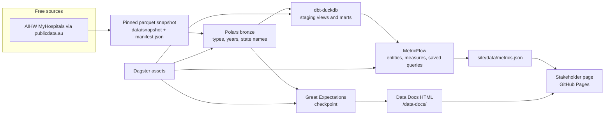

# Elective surgery waits

[](https://github.com/LuciferDataEngineer/elective-wait-metrics/actions/workflows/ci.yml)
[](https://luciferdataengineer.github.io/elective-wait-metrics/)

Australian public hospitals, elective surgery, 2011–12 to 2024–25. The question this project answers is which states, peer groups, urgency categories, and hospitals are missing the recommended wait, and where attention should go first.

**Dashboard:** [luciferdataengineer.github.io/elective-wait-metrics](https://luciferdataengineer.github.io/elective-wait-metrics/)

**Data Docs:** [luciferdataengineer.github.io/elective-wait-metrics/data-docs/](https://luciferdataengineer.github.io/elective-wait-metrics/data-docs/)

The page is for a health-system reader. It has five tabs (Overview, States, Hospitals, Urgency, What to do), large figures, and short explanations. The notes for a technical reader are this file and [INSIGHTS.md](INSIGHTS.md).

## The decision

In 2024–25 the Australian Institute of Health and Welfare reports that half of public elective patients were admitted within **45 days**, and **6.0%** waited more than a year (down from 6.4% and 46 days the year before). About **791,000** people were admitted from public waiting lists. Those are patient-level figures. They are cited here and are not rebuilt by averaging hospital rows.

The hospital and specialty tables, which this pipeline does compute, show the same national long-wait story at **5.9%** of **790,528** operations, and they show that the miss is not spread evenly:

- Tasmania treated **65.7%** of urgent surgery within 30 days. Victoria’s published hospital figures are at **100%**, New South Wales at **99.0%**.
- The ACT treated **51.7%** of semi-urgent surgery within 90 days. Nationally that share is **72.0%**, about **86,150** people outside the 90-day mark.
- Waits over a year are **9.4%** in the ACT and **9.2%** in New South Wales, and **3.4%** in Queensland. Victoria improved by **2.7** percentage points since 2023–24. New South Wales went the other way, up **1.3** points.
- The largest single hospital gaps are not always the hospitals with the longest typical wait. Sydney Eye’s non-urgent list and Royal Adelaide’s urgent list are both about **2,200–2,400** people outside the recommended time. At Royal Adelaide the typical urgent patient was still inside 30 days.

Quantified notes, including year-on-year procedure changes, are in [INSIGHTS.md](INSIGHTS.md).

## What’s new vs the previous project

The previous portfolio project, grocery-shock-agent, used Polars for bronze, Great Expectations checkpoints, dbt-duckdb gold marts, and Dagster, then spent its new depth on DuckDB vector search (VSS HNSW) and a deterministic six-tool ReAct agent over ABS CPI and RBA F1.

This project keeps the warehouse shape and changes the depth:

1. **dbt MetricFlow semantic layer.** Entities for hospital, state, financial year (`report_year`, because `year` is a reserved time grain), urgency, specialty, and procedure. Measures for admissions, published waits, the share treated within the recommended time, and two overdue-risk proxies (`outside_recommended_admissions` and `overdue_pressure`). Ratio metrics, one derived metric (`share_outside_recommended`), and nine saved queries. The stakeholder JSON is produced by `mf query --saved-query`, not by a second set of hand-written aggregations.
2. **Great Expectations Data Docs.** The same checkpoint run that tests the bronze files writes an HTML data-docs site and publishes it next to the stakeholder page at `/data-docs/`.

There is no vector index, no agent, and no feature store. DuckDB is the warehouse. Nothing here calls a paid API or a paid warehouse.

## Architecture



CI rebuilds from the committed snapshot. It does not download the source files again.

## Tech stack

| Piece | Choice | Why |
| --- | --- | --- |
| Warehouse | DuckDB | Local, free, and enough for about 200,000 indicator rows. No Postgres. |
| Bronze | Polars | Typed read of the parquet snapshot, financial-year parsing, checksum gate. |
| Marts | dbt-duckdb 1.11 | Grain rules and additive components live in SQL, with tests on keys and the national share. |
| Metrics | dbt MetricFlow 0.15 (`mf`) | One definition of each share and wait, queried through saved queries. |
| Orchestration | Dagster 1.13 | Four assets: bronze, dbt plus MetricFlow validate, metric export, data docs. |
| Quality | Great Expectations 1.8 | Row counts, keys, ranges, and HTML Data Docs. |
| Page | HTML, CSS, ECharts | No frontend build. Five tabs. Chart file is vendored. |
| Tests | pytest, ruff, dbt tests | Snapshot checksums, semantic-layer presence, and dashboard numbers checked back to the parquet. |
| Host | GitHub Actions and Pages | Free tier. The Pages workflow uploads the `site/` directory. |

## Data sources

All of this is free. No API key. Access date **8 November 2026** (Australia/Melbourne).

| Dataset | Publisher | URL | Licence | Coverage | Pin used here |
| --- | --- | --- | --- | --- | --- |
| Elective surgery waiting times by hospital and urgency | AIHW MyHospitals, redistributed by National Digital | https://publicdata.au/d/au-elective-surgery-waiting-times/v/2026-10-03/data.parquet | CC BY 4.0 | 2011–12 to 2024–25, hospitals and local networks, 12,159 rows | `data/snapshot/elective_surgery_waiting_times.parquet` |
| By intended procedure | same | https://publicdata.au/d/au-elective-surgery-waiting-times-by-procedure/v/2026-10-20/data.parquet | CC BY 4.0 | Hospitals, networks, states, and national, 183,929 rows | `data/snapshot/elective_surgery_by_procedure.parquet` |
| By surgical specialty | same | https://publicdata.au/d/au-elective-surgery-waiting-times-by-specialty/v/2026-10-20/data.parquet | CC BY 4.0 | Same reporting levels, 27,902 rows | `data/snapshot/elective_surgery_by_specialty.parquet` |
| National 45-day and 6% figures | AIHW, Elective surgery waiting times 2024–25 | https://www.aihw.gov.au/hospitals/topics/elective-surgery | AIHW website, figures quoted with attribution | Patient-level national summary | `data/reference/published_national.json` |

`data/manifest.json` stores the SHA-256 and row count of each snapshot. `make ingest` refuses to continue if either drifts.

National Digital converted the publisher’s files, renamed columns, and turned suppressed cells into nulls. The publisher did not write that conversion and has not endorsed the redistributor. The pipeline treats suppression as missing, not as zero.

## Cleaning

Polars, in `src/elective_wait/ingest.py`:

- Verify snapshot checksums and row counts.
- Parse financial years such as `2024–25` into `2024-25` and a report date of 1 July 2024, so the semantic layer has a real date.
- Map state codes, including `NAT` to `AUS` / Australia.
- Map urgency categories to Urgent / Semi-urgent / Non-urgent and to 30 / 90 / 365 days.
- Keep the list of suppressed fields as text. Do not fill missing waits with zero.
- Sort rows so the bronze files are stable.

dbt, after that:

- Hospital mart keeps `reporting_unit_type = 'Hospital'` only. Local hospital networks are dropped so a state total is not the hospitals plus the networks that contain them.
- Specialty and procedure marts keep official `State` and `National` rows. They are not a sum of hospitals.
- Rows with no admission count are dropped because they cannot be weighted.
- Additive components are the admission count times the published share, and the admission count times the published wait. MetricFlow sums those and divides. That is a real weighted share. It is not an average of medians unless the query is the weighted-wait metric, which is labelled as such and is not shown on the page as the national figure.
- `overdue_pressure` scales missed admissions by how far the published wait sits past the recommended number of days. It is zero when that published wait is still inside the limit. The page ranks hospitals on the plain count of missed admissions instead, because Royal Adelaide’s urgent list would otherwise disappear.

## Data model

| Model | Grain | What it is for |
| --- | --- | --- |
| `stg_waiting`, `stg_specialty`, `stg_procedure` | Bronze row | Casts only. |
| `fct_hospital_urgency` | Hospital × year × urgency | On-time shares, peer groups, hospital lists. |
| `fct_specialty_report` | State or national × year × specialty | Share waiting more than a year. Specialties partition admissions, so the weighted share is the overall share. State rows sum to the national row (790,528 in 2024–25). |
| `fct_procedure_report` | State or national × year × procedure | Published waits for named operations. Procedures overlap, so they are never added up to a national total. |
| `metricflow_time_spine` | Day, 2011–2026 | Required by MetricFlow. Facts also carry `financial_year`. |

Semantic models and saved queries are in `transform/models/marts/_semantic.yml`.

### MetricFlow metrics

Hospital urgency:

- `admissions`, `on_time_admissions`, `outside_recommended_admissions` (overdue-risk proxy: admissions treated outside the recommended time)
- `overdue_pressure` (second proxy: that count scaled by days past the recommended limit)
- `share_on_time` (ratio), `share_outside_recommended` (derived, `1 - share_on_time`)
- `weighted_wait_days` (ratio of published wait × admissions). Not a patient-level median.
- `published_wait_days` (minimum, so it is only meaningful when the query is already one published row, which the hospital and procedure saved queries are)
- `listings_past_recommended_wait`

Specialty and procedure metrics follow the same pattern: `share_waited_over_year`, `specialty_weighted_wait_days`, `procedure_published_wait_days`, and the admission components.

Saved queries that feed the page: `hospital_urgency_national`, `hospital_urgency_state`, `hospital_state`, `hospital_peer`, `hospital_listing`, `specialty_national`, `specialty_state`, `specialty_breakdown`, `procedure_breakdown`.

The 45-day and 6.0% figures are not metrics. They are the Institute’s patient-level publication, stored in `data/reference/published_national.json` and labelled on the page as the national figure. A surgery-weighted average of specialty waits in 2024–25 is **52.9 days**. The page does not present that number as the national wait. It is in the JSON under `audit` so the difference stays visible to anyone reading the file.

## How to run

Python 3.12. From a clean checkout:

```bash
make setup
make all
```

`make all` materialises the Dagster assets and then runs ruff and pytest.

| Target | What it does |
| --- | --- |
| `setup` | Create `.venv` and install `requirements.txt` |
| `ingest` | Check the manifest and write `data/bronze/*.parquet` |
| `transform` | `dbt build` and `mf validate-configs` |
| `metrics` | Run the nine saved queries and write `site/data/metrics.json` |
| `docs` | Great Expectations checkpoint and copy Data Docs to `site/data-docs/` |
| `dashboard` | Same as `metrics` |
| `test` | ruff and pytest |
| `all` | Dagster, then test |

Open the page locally:

```bash
python3 -m http.server 8765 --directory site
```

Then visit http://127.0.0.1:8765/ . The data-docs index is http://127.0.0.1:8765/data-docs/ .

Useful checks after a build:

```bash
cd transform && mf list metrics
cd transform && mf query --saved-query specialty_national --limit 5
```

`DBT_PROFILES_DIR` points at `transform/profiles.yml`. The DuckDB file is `data/warehouse/elective.duckdb`, created on the first transform. Both paths are set by the Makefile.

## Testing and CI

GitHub Actions workflow `ci` runs `make all` on pull requests and on `main`. That covers:

- ruff
- pytest: snapshot checksums, rounding, the semantic YAML contract, dashboard language, and the 2024–25 national share matched back to the specialty parquet (790,528 admissions, 5.9%)
- dbt tests inside the Dagster transform asset, including a lock that the national over-a-year share is 0.0593579
- `mf validate-configs` against DuckDB
- the Great Expectations checkpoint

Workflow `pages` rebuilds the site on every push to `main` and deploys the `site/` directory with `actions/upload-pages-artifact` and `actions/deploy-pages`. The five-tab dashboard and the Great Expectations Data Docs are that one site:

- Dashboard: https://luciferdataengineer.github.io/elective-wait-metrics/
- Data Docs: https://luciferdataengineer.github.io/elective-wait-metrics/data-docs/

The first deploy has a prerequisite the workflow cannot create for itself. In the repository settings, Pages must already be turned on with **GitHub Actions** as the source before `deploy-pages` runs. A green build followed by `Creating Pages deployment failed` (HTTP 404, “Ensure GitHub Pages has been enabled”) means that setting was still off. It does not mean `.github/workflows/pages.yml` is wrong. The file already requests `contents: read`, `pages: write`, and `id-token: write`, uploads `site/`, and deploys into the `github-pages` environment. Turning Pages on does not rerun the failed job. The next push to `main` starts a new deploy. A merged pull request is enough. The two URLs above answer only after that run succeeds.

## Limitations and next steps

- Waiting times describe people who were admitted. They do not describe the people still on the list today.
- The 45-day national figure cannot be recomputed from these indicator rows. Do not average the medians and call the result a median. The 52.9-day weighted specialty figure is the trap.
- Hospital on-time shares omit suppressed cells and omit local hospital networks. Small hospitals with a handful of operations can move a median a long way. The hospital list on the page is ordered by how many people missed the recommended time.
- Rebuilt headcounts inherit rounding in the published percentages.
- The Northern Territory has an AIHW note about possible duplicate records. Read the NT trend more cautiously than New South Wales or Victoria.
- This extract does not include the Institute’s “average overdue wait” indicator. AIHW says that indicator is not comparable across states because it depends on urgency assignment. It is not estimated here.
- Peer-group names in the MyHospitals indicator file (major hospitals, large regional hospitals, and so on) are not the same labels as “principal referral” in the national commentary.
- A later version can add the free MyHospitals directory of hospital coordinates, and can refresh the snapshot when publicdata.au publishes a new pinned version. Update `data/manifest.json` in the same commit.

## Licence

Code in this repository is MIT. See [LICENSE](LICENSE). The snapshot tables are AIHW data redistributed by National Digital under CC BY 4.0. Attribute the Australian Institute of Health and Welfare.
